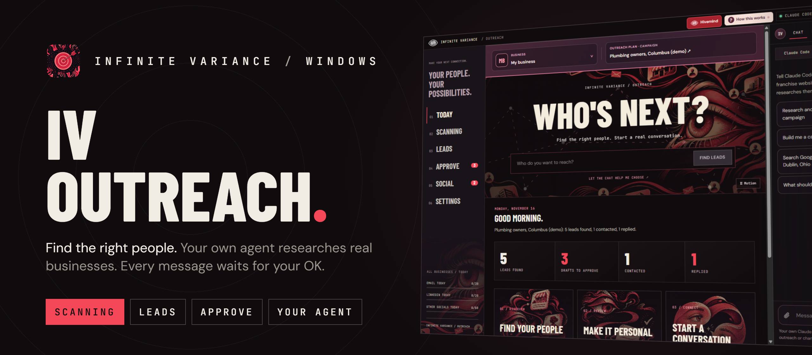
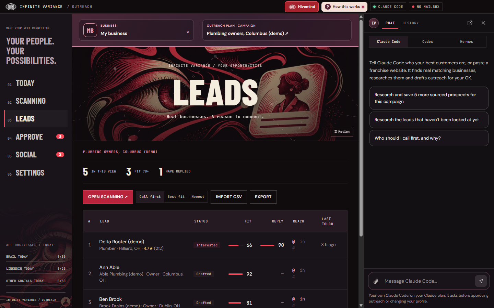
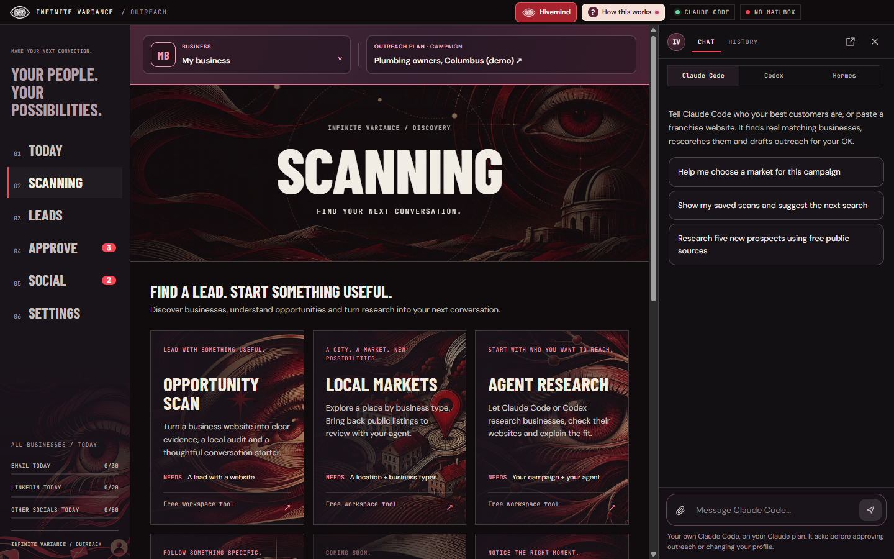
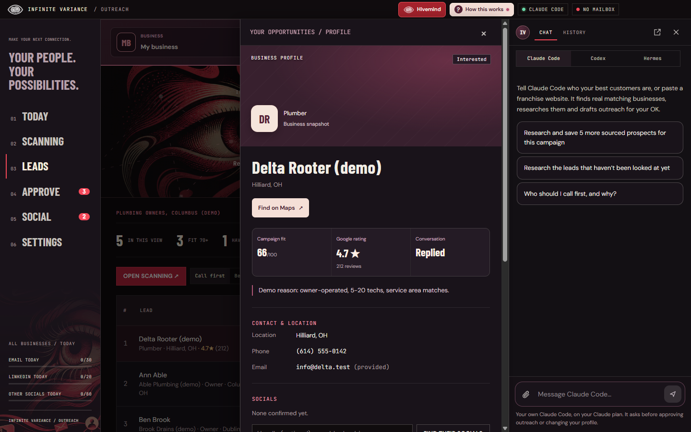
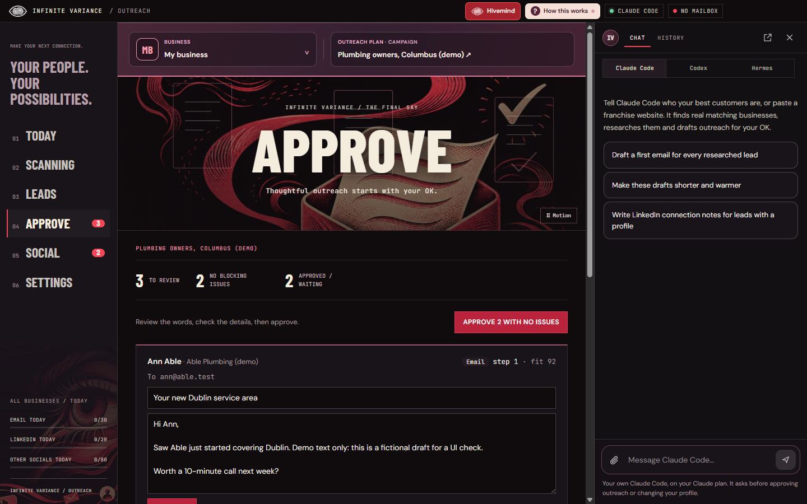
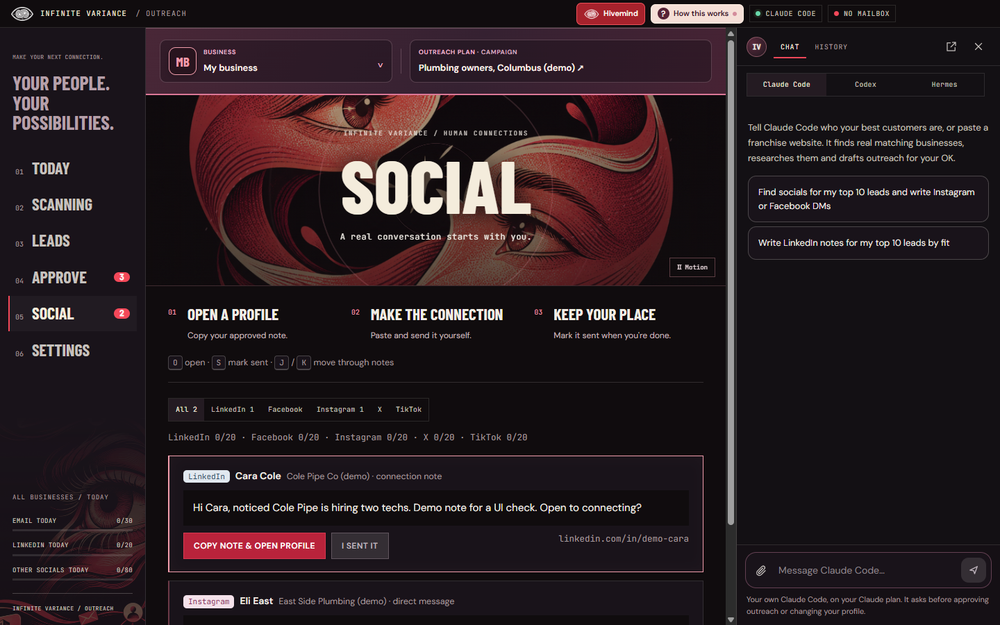
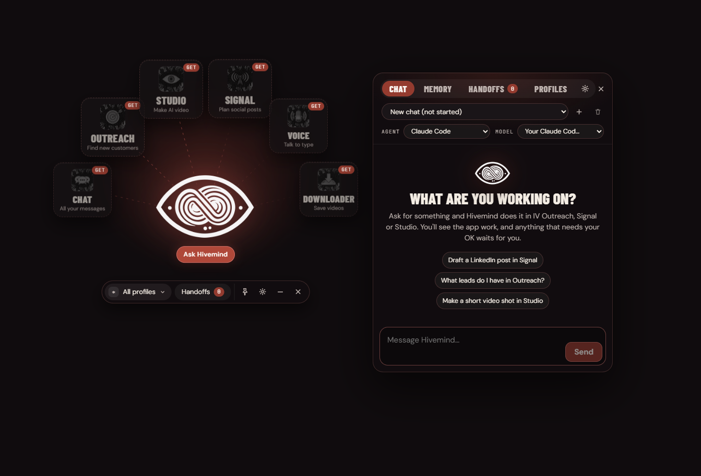

<p align="center">
  
</p>

<p align="center">
  <a href="https://github.com/hollisorg/iv-outreach/releases/latest"><b>Download for Windows or Mac</b></a>
  &nbsp;·&nbsp;
  <a href="https://github.com/hollisorg/iv-hivemind-releases/releases/latest/download/IV-Hivemind-Setup.exe"><b>IV Hivemind</b></a>
  &nbsp;·&nbsp;
  <a href="#what-you-need">What you need</a>
  &nbsp;·&nbsp;
  <a href="https://github.com/hollisorg/iv-outreach/releases/latest">Release notes</a>
  &nbsp;·&nbsp;
  <a href="https://infinitevariance.ai">Infinite Variance</a>
</p>

# IV Outreach

A free Infinite Variance desktop app for finding and researching real businesses for your outreach, from a
chat with your own **Claude Code, Codex or Hermes**. IV Outreach keeps your campaigns, leads, research and
drafts on your PC, and nothing is sent without your approval.

**[IV Hivemind](#iv-hivemind)**, the desktop overlay that opens and connects the IV apps, has its own repository:
[hollisorg/iv-hivemind](https://github.com/hollisorg/iv-hivemind).

<p align="center">
  
</p>

## What it does

- **Today.** Say who you want to reach and your agent turns it into research. The page shows what your
  campaign has found, what's waiting for approval, who you've contacted and who replied.
- **Chat with your own agent.** Tell it what you sell, who you want to reach and where. It researches
  businesses on the public web and saves what it finds, with sources. It asks before it approves outreach
  or changes your profile.
- **Scanning.** A gallery of free workflows: **Local markets** by business type, **Agent research**, custom
  Maps searches, an **Opportunity scan** that turns a business website into source evidence and Lighthouse
  findings, **watchlists** that compare a page or feed with what it said before, and **content briefs** for
  IV Studio and IV Signal.
- **Leads you can trust.** Each lead keeps its observations, fit reasons, opportunities and unknowns apart,
  with its website, rating, contact details and sources. Unknowns stay marked; nothing is invented.
- **Approve.** Read every draft before it goes. Approval lets email enter your connected mailbox's sending
  queue, and you choose whether approved email sends by itself.
- **Social.** LinkedIn, Facebook, Instagram, X and TikTok messages stay manual: open the profile, paste your
  approved note, send it yourself and mark it sent, so your follow-up history stays useful.
- **Respect the no.** A do-not-contact list applies across all your businesses and campaigns, and any reply
  stops pending follow-ups.
- **Several businesses**, each with its own logo, cover, colour and business brief, and campaigns as simple
  outreach plans with their own goal, audience and leads.
- **Works with the other IV apps** through [IV Hivemind](#iv-hivemind): shared profiles, shared memory and
  handoffs. Connect it to Claude Code, Codex or Claude Desktop through MCP and they work on the same leads.
- **A How this works tour on every page**, and it updates itself.

Public research can find websites, published contacts and business facts. It can't promise private emails,
verified deliverability or buying intent.

**Premium** (paid contact data and extra reach) is coming soon. Everything in IV Outreach today is free.

<table>
  <tr>
    <td width="50%"></td>
    <td width="50%"></td>
  </tr>
  <tr>
    <td align="center"><sub>Scanning: free ways to find your next conversation</sub></td>
    <td align="center"><sub>A lead, with its research, fit and contact details</sub></td>
  </tr>
  <tr>
    <td width="50%"></td>
    <td width="50%"></td>
  </tr>
  <tr>
    <td align="center"><sub>Approve: every message waits for your OK</sub></td>
    <td align="center"><sub>Social: you send it yourself, IV Outreach keeps track</sub></td>
  </tr>
</table>

## What you need

- **Windows 10 or 11**, 64-bit, or **macOS 12 or newer** on Apple Silicon or Intel (IV Hivemind is Windows only for now).
- **Your own agent for the chat and research:** [Claude Code](https://claude.com/claude-code),
  [Codex](https://openai.com/codex) or Hermes, signed in on your own plan. Free discovery doesn't need a paid
  data-provider account.
- **Optional:** a Google or Microsoft mailbox if you want approved email to send from IV Outreach.

## Install

1. Download the newest `IV-Outreach-Setup-<version>.exe` from
   [the releases page](https://github.com/hollisorg/iv-outreach/releases/latest).
2. Run it. The installer isn't code-signed yet, so Windows may show **"Windows protected your PC"**.
   Choose **More info → Run anyway**.
3. Open IV Outreach and follow the guided setup: your business, your agent and, if you like, your mailbox.

**On a Mac:** download `IV-Outreach-mac-arm64.dmg` (Apple Silicon) or `IV-Outreach-mac-x64.dmg` (Intel) from the same page,
open it and drag IV Outreach into Applications. It isn't signed with an Apple Developer ID yet, so the first time
macOS won't open it: go to **System Settings → Privacy & Security** and click **Open Anyway**. Open it from
Applications (not the disk image) so it can update itself.

IV Outreach updates itself from this repository's releases, with no account or sign-in needed. It checks
when it opens and every six hours, downloads new versions in the background, and installs them when you
close it. **Settings → App updates** shows your version, with Check for updates and Restart and install,
and lets you turn automatic updates off. Your data is kept in `%APPDATA%\Fitscout` (IV Outreach's working
name; `~/Library/Application Support/Fitscout` on a Mac).

## IV Hivemind

<p align="center">
  
</p>

IV Hivemind floats over your desktop. Its eye sits in the middle with your IV apps around it (Studio, Signal,
Outreach, Chat, Voice and Downloader): click one to open it, or **Get** to install it. It carries your
business profiles and memory between the apps, keeps track of **handoffs** (a brief from Outreach becomes a
project in IV Studio, and the finished picture or video becomes an unapproved post in IV Signal), and its
**chat** works in those apps for you through your own Claude Code or Codex. You see the app work, and
anything that needs your OK waits for you.

[Download `IV-Hivemind-Setup.exe`](https://github.com/hollisorg/iv-hivemind-releases/releases/latest/download/IV-Hivemind-Setup.exe).
Its installers and updates are published from [iv-hivemind-releases](https://github.com/hollisorg/iv-hivemind-releases);
the source is in [hollisorg/iv-hivemind](https://github.com/hollisorg/iv-hivemind) (until 2026-11-19 it lived
here, in `apps/hivemind`). It updates itself; the gear button shows its version.

## Build it yourself

You need Node.js 24 on Windows.

```
npm ci
node node_modules/electron/install.js   # npm 11 skips Electron's install script
npm test
npm run dist   # IV Outreach installer in dist/
```

`npm run dev` runs it from source. The Google Maps scraper used by local
searches isn't in git; `node scripts/restore-vendor.mjs` fetches the pinned release (see
`vendor/README.md`). `node scripts/ui-check.mjs <folder>` opens the built app on a throwaway database of
fictional demo data and screenshots each page; the screenshots here come from it.

## Licence

MIT (see [LICENSE](LICENSE)). Bundled third-party tools and data keep their own licences, listed in
`vendor/README.md`. The Infinite Variance artwork is Infinite Variance's own and isn't covered by the MIT
licence. The businesses in the screenshots are fictional and marked "(demo)".

## Signed Windows release builds

Run `npm run dist:win-release` on Windows to stage a signed installer, blockmap, and updater
manifest in `dist/`. Use the Hollis Azure tenant in Azure CLI, with the .NET 10 x64 runtime
and Windows SDK 22621 or newer installed. The release build checks the publisher, timestamp,
and updater checksum before it succeeds. `npm run dist` is for unsigned development builds.
